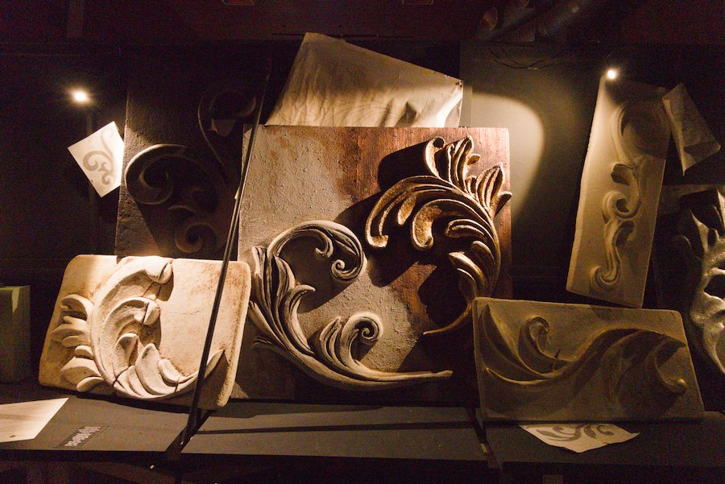
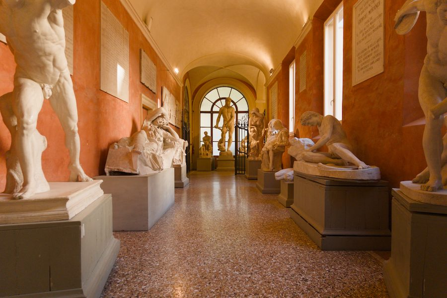
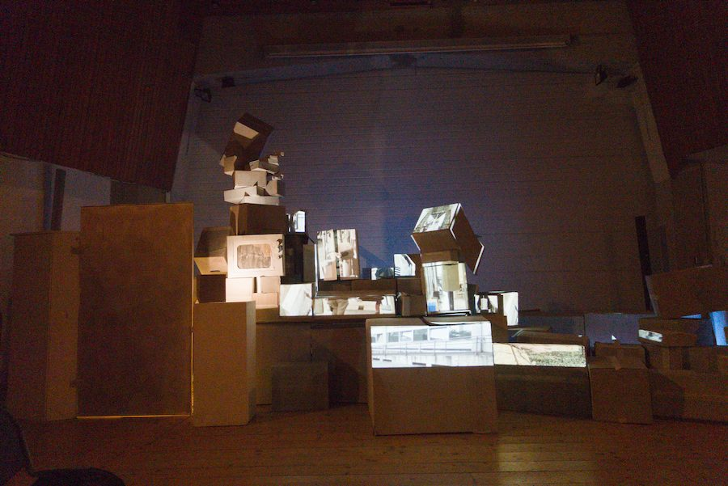

# Esercizi con RAW

Tre file RAW scattati nella stessa sessione (Sony RX100 VI, gipsoteca), scelti perché ognuno pone un problema diverso. Scaricali, aprili in darktable e lavora con gli obiettivi indicati. Per il primo c'è anche la soluzione passo per passo.

!!! note "Uso dei file"
    © Lorenzo Perone. I RAW sono forniti per esercitarsi con questa guida.

!!! tip "Come lavorare"
    Importa il file in darktable con il flusso scene-referred di default (vedi [Importazione](../workflow/import.md)). Prima di toccare un modulo, scrivi su un foglio cosa non ti convince dell'immagine: è l'abitudine più utile che puoi prendere. Poi confronta il risultato con la checklist.

## Esercizio 1 — Rilievi sotto i faretti

{ loading=lazy }

**Dati di scatto:** ISO 3200 · 1/60 s · f/4 · 9 mm. **Livello:** [1](../percorso.md#livello-1-primi-passi).

**Il problema:** scena scura con luci puntiformi molto intense. All'apertura i faretti sono già al limite e le ombre sono chiuse.

**Obiettivi:**

1. Portare i rilievi (i toni medi) a una luminosità piena, senza preoccuparti dei faretti.
2. Aprire le ombre e contenere le alte luci per zone.
3. Dare tridimensionalità agli intagli.
4. Dare un po' di vivacità al colore senza esagerare con il calore della luce.

[:material-download: Scarica il RAW (21 MB)](raw/DSC08237.ARW){ .md-button download }

**Soluzione:** è la [lezione interattiva](../workflow/lezione-interattiva.md), con la cronologia XMP di ogni passo. Per confrontarla con la tua: in *lighttable* duplica l'immagine e, nel modulo **cronologia**, usa **carica file sidecar** sul duplicato con l'XMP dell'ultimo passo.

??? question "Checklist di verifica"
    - Esposizione aumentata di circa un EV rispetto all'apertura, giudicando i rilievi e non i faretti.
    - Ombre aperte senza aloni attorno ai bordi dei rilievi (se compaiono, la maschera del *tone equalizer* è troppo sfocata o troppo poco).
    - Rumore: a ISO 3200 un passaggio di *denoise (profiled)* è giustificato; valuta al 100%.
    - Il colore resta caldo (è la luce reale della scena), ma il gesso non diventa arancione.

## Esercizio 2 — Il corridoio delle statue

{ loading=lazy }

**Dati di scatto:** ISO 800 · 1/60 s · f/2.8 · 9 mm. **Livello:** [2](../percorso.md#livello-2-controllo-del-colore-e-delle-zone).

**Il problema:** dominante calda della luce artificiale, finestra luminosa in fondo, grandangolo con le verticali che convergono.

**Obiettivi:**

1. Decidere quanta dominante calda tenere: neutralizzarla in parte con *color calibration* (scheda CAT) campionando il gesso delle statue, poi scegliere se riscaldare di nuovo l'atmosfera.
2. Raddrizzare le verticali con *rotate and perspective* (correzione automatica sulle linee verticali) e ritagliare.
3. Recuperare la finestra in fondo senza appiattire il corridoio: prova sia il tone mapper sia il *tone equalizer*.

[:material-download: Scarica il RAW (21 MB)](raw/DSC08210.ARW){ .md-button download }

??? question "Checklist di verifica"
    - Il gesso è chiaro e quasi neutro; il pavimento e le pareti conservano il loro colore.
    - Stipiti delle porte e bordi delle teche verticali; nessuna statua tagliata male dal ritaglio.
    - La finestra mostra dettaglio, ma resta la zona più luminosa: la gerarchia di luce della scena è rispettata.
    - Nessun alone scuro attorno alla finestra (segno di una maschera del *tone equalizer* troppo nitida).

## Esercizio 3 — L'installazione al buio

{ loading=lazy }

**Dati di scatto:** ISO 3200 · 1/60 s · f/4 · 9 mm. **Livello:** [3](../percorso.md#livello-3-tecniche-avanzate).

**Il problema:** luce mista (proiezioni fredde, ambiente caldo), soggetto piccolo al centro di una sala buia, rumore ad alta sensibilità.

**Obiettivi:**

1. Scegliere un riferimento di bianco tra le due luci e motivarlo; prova anche una seconda istanza di *color calibration* con maschera su una sola zona.
2. Guidare lo sguardo verso l'installazione: alza e contrasta il centro, lascia scendere la sala (*tone equalizer*, maschere disegnate o *vignetting*).
3. Gestire il rumore nelle zone scure senza impastare le texture delle casse.

[:material-download: Scarica il RAW (21 MB)](raw/DSC08239.ARW){ .md-button download }

??? question "Checklist di verifica"
    - Le proiezioni non sono bruciate e non virano verso il magenta.
    - L'occhio va subito all'installazione; la sala resta leggibile ma secondaria.
    - Nelle ombre il rumore è controllato e non ci sono macchie di colore.
    - Se hai usato più istanze o maschere, le transizioni non si vedono.
