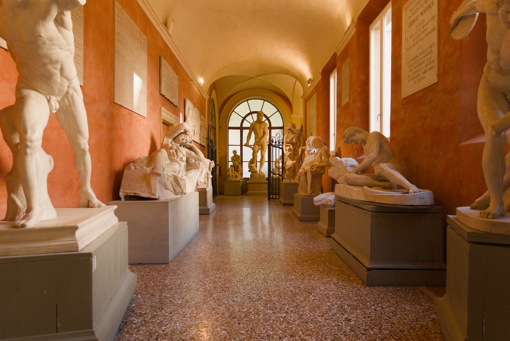
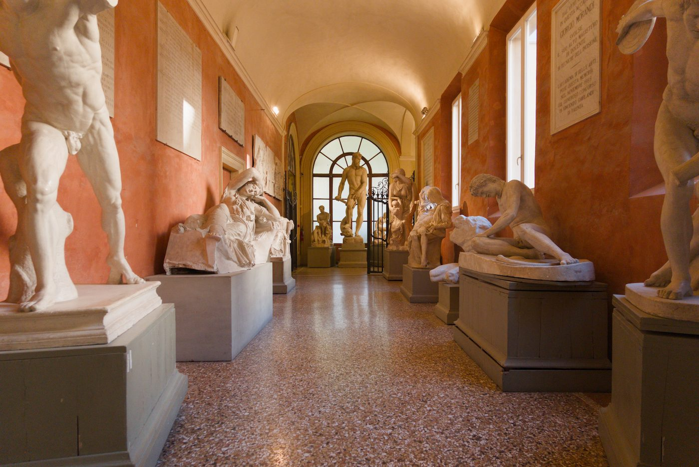
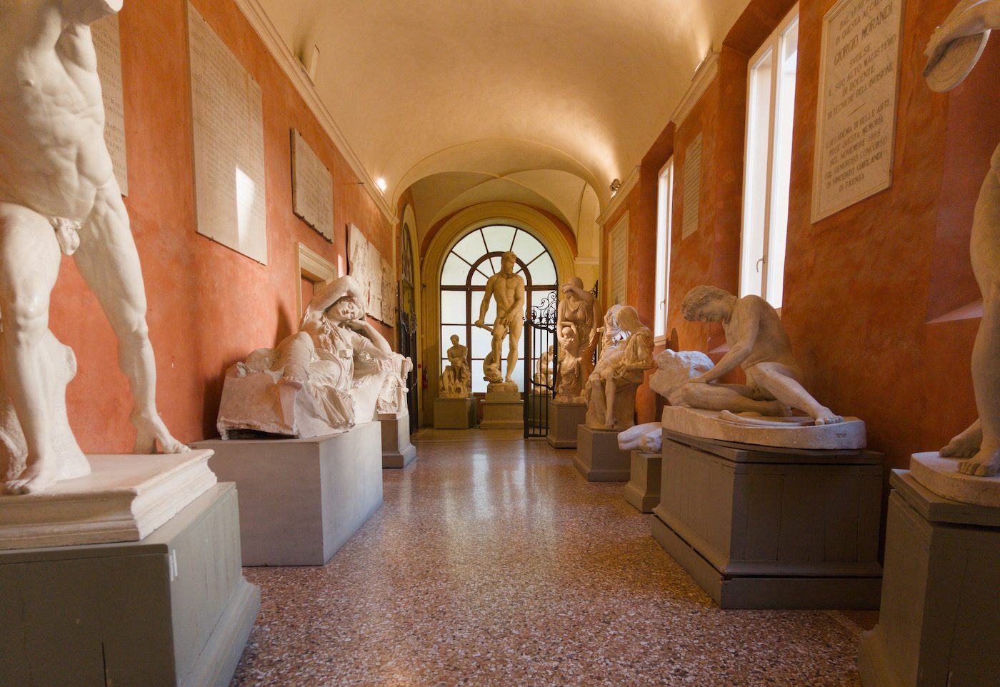
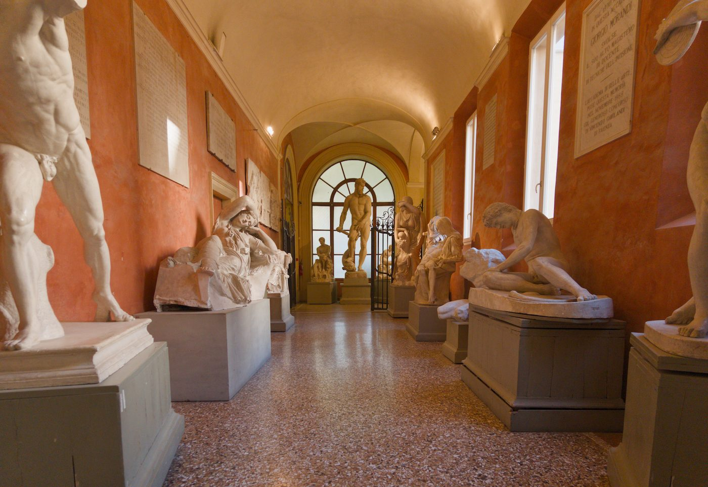

# Soluzione: il corridoio delle statue

Una possibile soluzione dell'[esercizio 2](index.md#esercizio-2-il-corridoio-delle-statue), passo per passo. Non è l'unica: in particolare la quantità di calore da lasciare è una scelta, e il primo passo la mostra apposta con un valore intermedio.

Le immagini sono generate da `darktable-cli` a partire dalla cronologia (*history stack*) di ciascun passo, che puoi scaricare.

!!! tip "Come usare il confronto"
    Scegli un passo con i pulsanti, poi trascina il cursore sull'immagine: a sinistra lo stato di riferimento (il passo precedente oppure l'apertura), a destra il risultato del passo. Le stesse immagini sono riportate qui sotto, passo per passo.

## Passo 0 — Apertura

Il RAW con i default scene-referred. All'apertura calibrazione colore stima l'illuminante dai metadati di scatto: un corpo nero a circa 4150 K. Il risultato è ancora caldo: il gesso tende all'arancio e le pareti rosse sono sature.

Approfondisci: [Calibrazione colore](../modules/color-calibration.md)

{ loading=lazy }

[:material-download: Cronologia XMP di questo passo](../images/lezioni/esercizio-corridoio/passo-0.xmp){ .md-button download }

## Passo 1 — Bilanciamento

Calibrazione colore, scheda CAT: temperatura dell'illuminante portata a 3600 K. Dire a darktable che la luce era più calda di quanto stimato aumenta la correzione: il gesso torna quasi neutro, ma resta un filo di calore, che è la luce reale del luogo. Con 3200 K il gesso diventa del tutto neutro e la scena perde atmosfera.

Approfondisci: [Calibrazione colore](../modules/color-calibration.md) · [Bilanciamento del bianco](../color/white-balance.md)

{ loading=lazy }

[:material-download: Cronologia XMP di questo passo](../images/lezioni/esercizio-corridoio/passo-1.xmp){ .md-button download }

## Passo 2 — Prospettiva

Rotazione e prospettiva: spostamento verticale +0,12, con la focale (9 mm) e il fattore di crop (2,7) della fotocamera e un ritaglio dei margini per eliminare i bordi vuoti. Gli spigoli dei piedistalli e l'infisso della finestra tornano verticali. In darktable conviene usare la correzione automatica sulle linee verticali, poi rifinire a occhio.

Approfondisci: [Rotazione e prospettiva](../modules/rotate-perspective.md)

{ loading=lazy }

[:material-download: Cronologia XMP di questo passo](../images/lezioni/esercizio-corridoio/passo-2.xmp){ .md-button download }

## Passo 3 — Finestra e corridoio

Equalizzatore toni, preset nativo «compress shadows/highlights | EIGF | soft»: abbassa un poco la finestra in fondo e apre il primo piano. Il preset morbido è sufficiente perché AgX ha già compresso le alte luci; uno più forte appiattirebbe la profondità del corridoio.

Approfondisci: [Equalizzatore toni](../modules/tone-equalizer.md)

{ loading=lazy }

[:material-download: Cronologia XMP di questo passo](../images/lezioni/esercizio-corridoio/passo-3.xmp){ .md-button download }

## Tutor in darktable

Puoi seguire questa lezione anche dentro darktable, con un pannello che ti guida passo per passo, verifica quello che hai fatto e, se serve, applica la soluzione. Istruzioni di installazione nel file LEGGIMI.txt dello zip.

[:material-download: Scarica il tutor per darktable](kit/esercizio-corridoio.zip){ .md-button download }

## Confronta con la tua versione

Scarica l'XMP dell'ultimo passo e caricalo su un duplicato della tua immagine (*lighttable* → modulo **cronologia** → **carica file sidecar**). Il confronto più utile è sul primo passo: quanta dominante calda hai lasciato tu, e perché?
