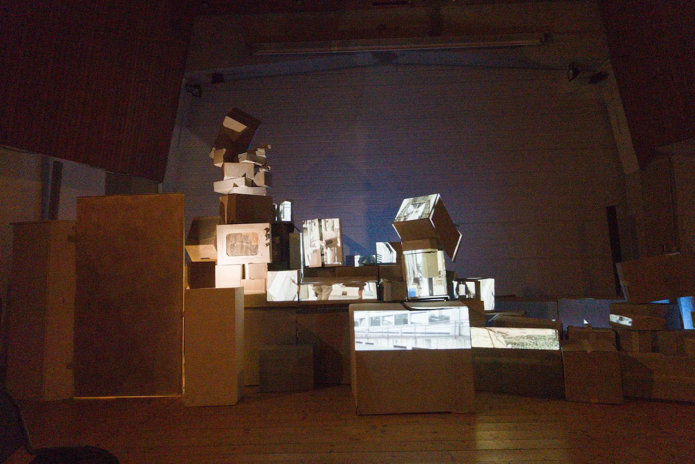
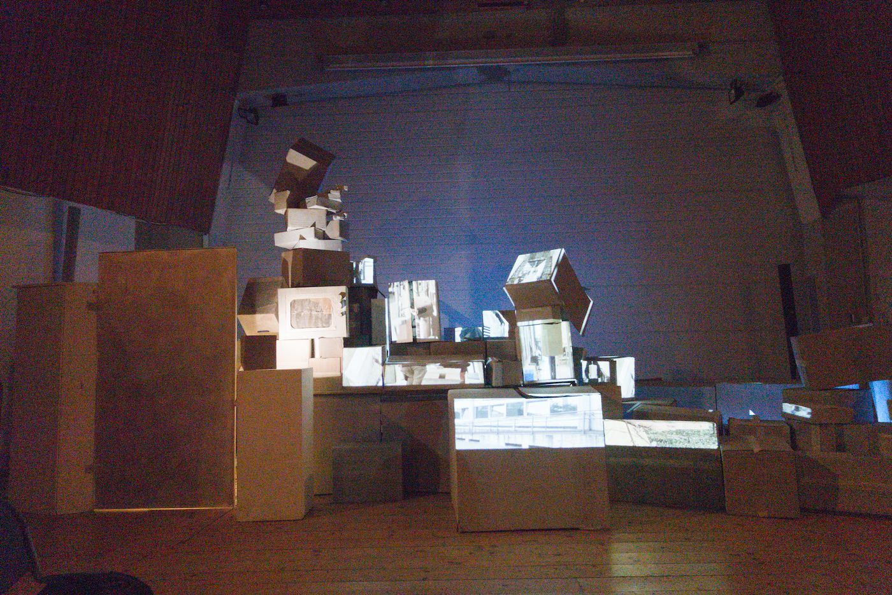
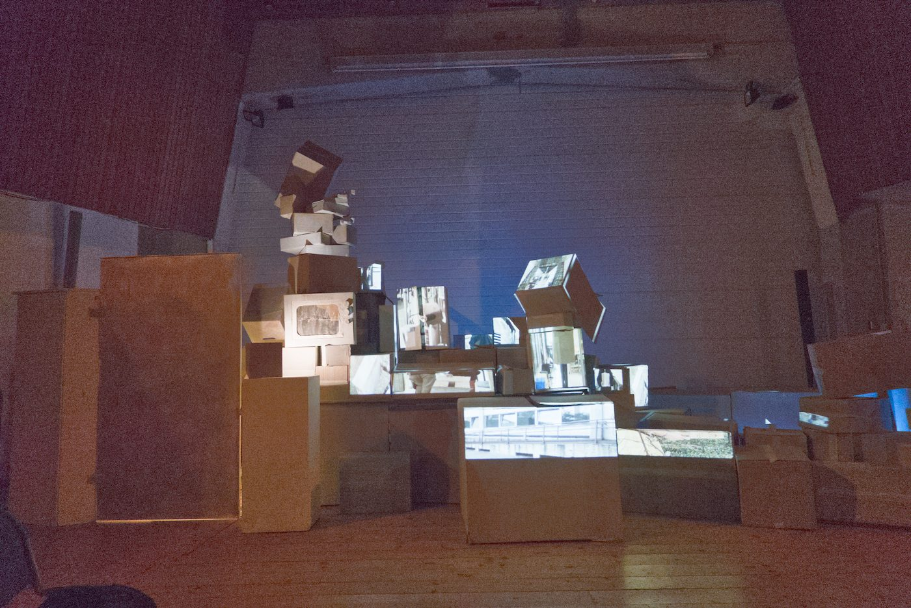

# Soluzione: l'installazione al buio

Una possibile soluzione dell'[esercizio 3](index.md#esercizio-3-linstallazione-al-buio), passo per passo. Con la luce mista non esiste un bilanciamento «giusto»: qui il riferimento è la luce calda della sala, e la scelta è spiegata nel primo passo.

Le immagini sono generate da `darktable-cli` a partire dalla cronologia (*history stack*) di ciascun passo, che puoi scaricare.

!!! tip "Come usare il confronto"
    Scegli un passo con i pulsanti, poi trascina il cursore sull'immagine: a sinistra lo stato di riferimento (il passo precedente oppure l'apertura), a destra il risultato del passo. Le stesse immagini sono riportate qui sotto, passo per passo.

## Passo 0 — Apertura

Il RAW con i default scene-referred. Calibrazione colore stima un illuminante intermedio (corpo nero a circa 4150 K) tra la luce calda della sala e quella fredda dei proiettori: nessuna delle due è davvero neutra. La sala è buia e l'installazione occupa una piccola parte dell'inquadratura.

Approfondisci: [Calibrazione colore](../modules/color-calibration.md)

{ loading=lazy }

[:material-download: Cronologia XMP di questo passo](../images/lezioni/esercizio-installazione/passo-0.xmp){ .md-button download }

## Passo 1 — Bilanciamento

Calibrazione colore, scheda CAT: illuminante a 3400 K, cioè riferimento sulla luce calda della sala. Legno e casse tornano quasi neutri, le superfici illuminate dai proiettori virano leggermente al freddo. Il contrasto caldo/freddo diventa uno strumento: separa l'installazione dall'ambiente. Prova anche la scelta opposta (riferimento sui proiettori, circa 5500 K) e confronta.

Approfondisci: [Calibrazione colore](../modules/color-calibration.md) · [Bilanciamento del bianco](../color/white-balance.md)

{ loading=lazy }

[:material-download: Cronologia XMP di questo passo](../images/lezioni/esercizio-installazione/passo-1.xmp){ .md-button download }

## Passo 2 — Esposizione

Esposizione da +0,7 a +1,3 EV, giudicando l'installazione e non le proiezioni, che AgX comprime verso il bianco. La sala si schiarisce insieme al resto: la si riporterà indietro nel passo successivo.

Approfondisci: [Esposizione](../modules/exposure.md)

{ loading=lazy }

[:material-download: Cronologia XMP di questo passo](../images/lezioni/esercizio-installazione/passo-2.xmp){ .md-button download }

## Passo 3 — Guidare lo sguardo

Equalizzatore toni, preset nativo «compress shadows/highlights | EIGF | medium»: contiene le proiezioni più luminose e solleva le casse in ombra. Per abbassare la sala rispetto all'installazione si possono poi aggiungere nodi negativi sulle ombre profonde, o una vignettatura leggera.

Approfondisci: [Equalizzatore toni](../modules/tone-equalizer.md)

{ loading=lazy }

[:material-download: Cronologia XMP di questo passo](../images/lezioni/esercizio-installazione/passo-3.xmp){ .md-button download }

## Passo 4 — Rumore

Riduzione rumore (profilato), preset nativo «wavelets: chroma only»: a ISO 3200 le ombre mostrano macchie di colore; questo preset agisce solo sul rumore cromatico e lascia intatta la grana di luminanza, quindi non impasta le texture delle casse. Valuta il risultato al 100%.

Approfondisci: [Riduzione rumore](../modules/denoise.md)

{ loading=lazy }

[:material-download: Cronologia XMP di questo passo](../images/lezioni/esercizio-installazione/passo-4.xmp){ .md-button download }

## Tutor in darktable

Puoi seguire questa lezione anche dentro darktable, con un pannello che ti guida passo per passo, verifica quello che hai fatto e, se serve, applica la soluzione. Istruzioni di installazione nel file LEGGIMI.txt dello zip.

[:material-download: Scarica il tutor per darktable](kit/esercizio-installazione.zip){ .md-button download }

## Confronta con la tua versione

Scarica l'XMP dell'ultimo passo e caricalo su un duplicato della tua immagine (*lighttable* → modulo **cronologia** → **carica file sidecar**). Il punto da discutere è il primo: quale luce hai preso come riferimento, e che effetto ha sul racconto della foto?
