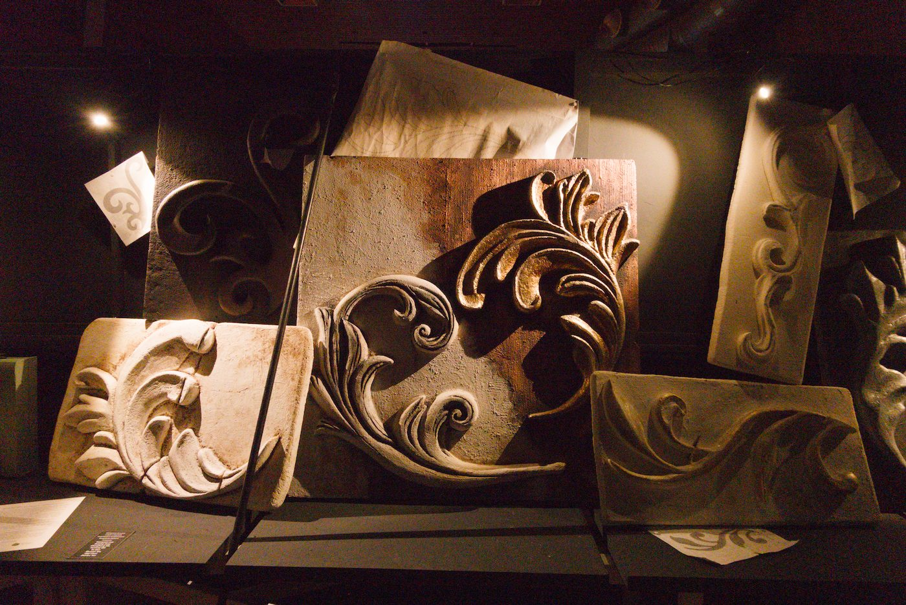
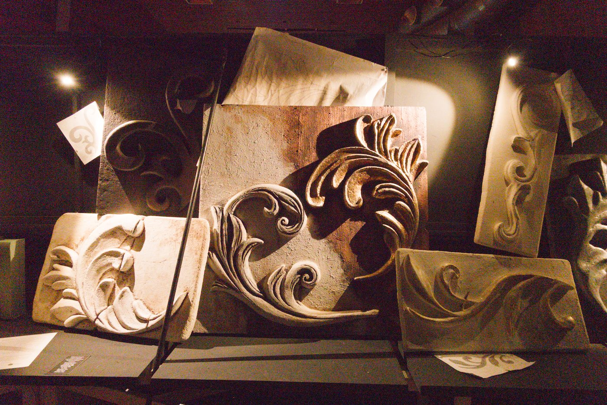
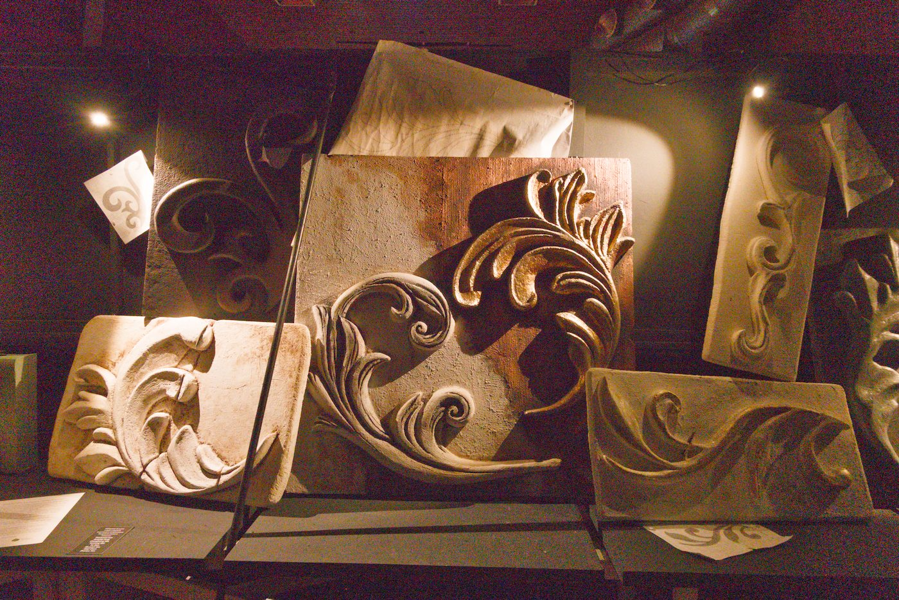
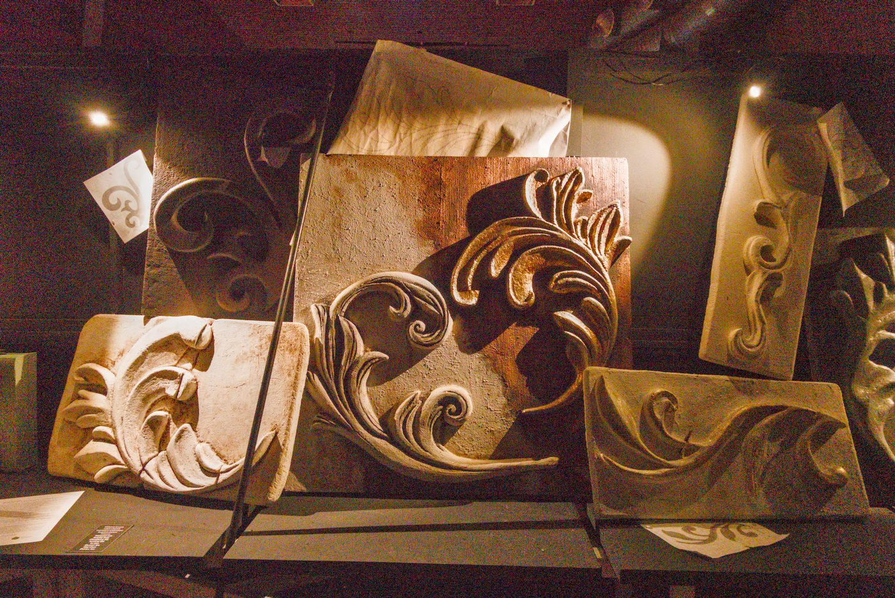

# Lezione interattiva: il flusso base in 5 passi

Questa lezione mostra il [flusso di lavoro scene-referred](index.md) applicato a una foto reale: rilievi in gesso illuminati da faretti, una scena scura con luci puntiformi molto intense (foto dell'autore). Ogni passo aggiunge **un solo modulo** alla cronologia, usando i preset nativi di darktable, quindi il risultato è riproducibile.

Le immagini non sono screenshot: sono generate da `darktable-cli` a partire dalla cronologia (*history stack*) di ciascun passo, che puoi scaricare e ispezionare.

!!! tip "Come usare il confronto"
    Scegli un passo con i pulsanti, poi trascina il cursore sull'immagine: a sinistra lo stato di riferimento (il passo precedente oppure l'apertura), a destra il risultato del passo. Le stesse immagini sono riportate qui sotto, passo per passo.

## Passo 0 — Apertura

Il RAW come lo apre darktable con il flusso scene-referred: bilanciamento del bianco con adattamento cromatico in calibrazione colore, esposizione di partenza +0,7 EV e tone mapper AgX con il suo preset di default (qui è attiva anche la correzione obiettivo). L'immagine è corretta ma scura: i faretti sono già al limite, le ombre sono chiuse.

Approfondisci: [Importazione e prima apertura](import.md) · [AgX](../modules/agx.md)

{ loading=lazy }

[:material-download: Cronologia XMP di questo passo](../images/lezioni/flusso-base/passo-0.xmp){ .md-button download }

## Passo 1 — Esposizione

Modulo esposizione: da +0,7 a +1,6 EV. Si imposta la luminosità dei toni medi (i rilievi) senza preoccuparsi delle luci: in scene-referred è il tone mapper (AgX) a comprimerle verso il bianco del monitor.

Approfondisci: [Esposizione](exposure.md) · [modulo esposizione](../modules/exposure.md)

{ loading=lazy }

[:material-download: Cronologia XMP di questo passo](../images/lezioni/flusso-base/passo-1.xmp){ .md-button download }

## Passo 2 — Ombre e luci

Equalizzatore tonale, preset nativo «compress shadows/highlights | EIGF | medium»: alza le ombre e abbassa le alte luci per zone, con una maschera guidata che preserva il contrasto locale. È l'equivalente ragionato di Ombre/Luci di Lightroom.

Approfondisci: [Equalizzatore tonale](../modules/tone-equalizer.md)

{ loading=lazy }

[:material-download: Cronologia XMP di questo passo](../images/lezioni/flusso-base/passo-2.xmp){ .md-button download }

## Passo 3 — Contrasto locale

Contrasto locale, preset nativo «clarity»: aumenta il dettaglio a media scala, qui la tridimensionalità degli intagli. Corrisponde a Chiarezza/Texture di Lightroom.

Approfondisci: [Contrasto locale](../modules/local-contrast.md)

{ loading=lazy }

[:material-download: Cronologia XMP di questo passo](../images/lezioni/flusso-base/passo-3.xmp){ .md-button download }

## Passo 4 — Colore

Bilanciamento colore RGB, preset nativo «basic colorfulness | vibrant colors»: aumenta vividezza, croma e saturazione lavorando in uno spazio percettivo, con un effetto più marcato sui colori poco saturi. È l'equivalente di Vividezza/Saturazione di Lightroom.

Approfondisci: [Colore](color.md) · [Bilanciamento colore RGB](../modules/color-balance-rgb.md)

{ loading=lazy }

[:material-download: Cronologia XMP di questo passo](../images/lezioni/flusso-base/passo-4.xmp){ .md-button download }

## Tutor in darktable

Puoi seguire questa lezione anche dentro darktable, con un pannello che ti guida passo per passo, verifica quello che hai fatto e, se serve, applica la soluzione. Istruzioni di installazione nel file LEGGIMI.txt dello zip.

[:material-download: Scarica il tutor per darktable](../esercizi/kit/flusso-base.zip){ .md-button download }

## Riusare la cronologia

Ogni file XMP contiene la cronologia fino a quel passo. Per applicarla a una tua foto: in *lighttable* seleziona l'immagine e, nel modulo **cronologia** (*history stack*), usa **carica file sidecar** (*load sidecar file*). Il risultato sarà diverso, perché esposizione e luce cambiano da scatto a scatto: è proprio il punto. I preset sono un punto di partenza, il passo di esposizione va sempre rifatto a occhio.

!!! note "Come è stata generata questa pagina"
    Le immagini sono rese in modo deterministico con `darktable-cli` dalla stessa cronologia XMP scaricabile: nessuna regolazione manuale fuori dalla cronologia. Quando esce una nuova versione di darktable basta rigenerarle.
